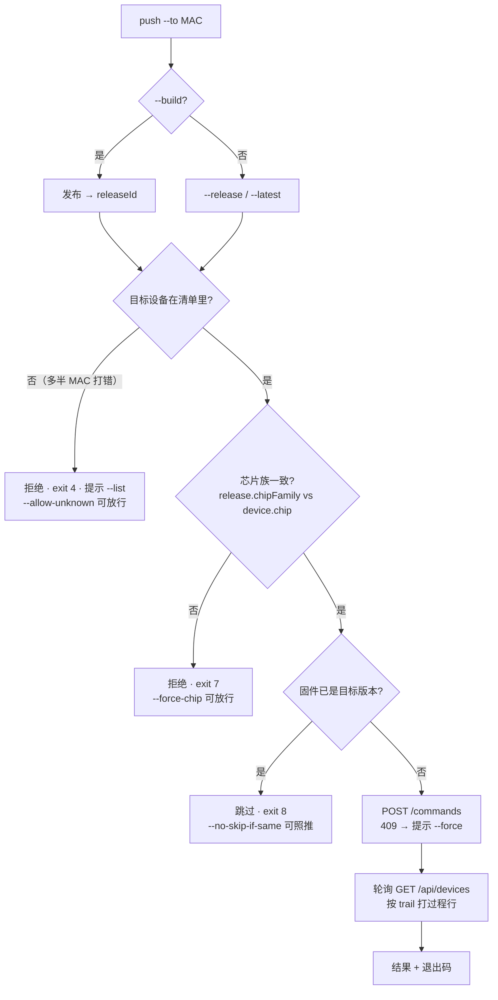
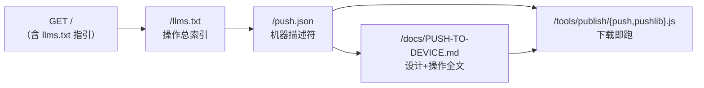

# PUSH-TO-DEVICE — 把固件推给指定设备（设计 + 操作）

> **状态：设计定稿，代码未实现**。实施清单见 §5，落地顺序见 §9。
> 实施前服务器上**不会**出现本功能的 AI 声明（`/push.json` 与 `llms.txt` 的对应段落与代码同批上线——描述符不得先于实现，见 §6.5）。
>
> **面向**：设备开发机（另一台电脑）上的操作者与其 AI。这份是"推送固件到设备"的**唯一入口文档**；
> 设备端固件本身的接入指南是 [`DEVICE-OTA.md`](./DEVICE-OTA.md)，OTA 三端契约是 [`ota.md`](./ota.md)。

## 0. 一页速览

| 项 | 内容 |
|---|---|
| 一句话 | 一条命令 = **发布（可选）+ 下发给指定设备 + 等结果 + 打印过程** |
| 命令 | `node tools/publish/index.js push --to <mac> [--build <dir> \| --release <id> \| --latest]` |
| 谁用 | 设备开发机（已持有发布 token 的那台）；**设备端固件无需任何改动** |
| 复用 | 发布 token、`POST /api/publish`、`GET /api/devices`、`POST …/commands`、`POST …/progress` |
| 服务端 | **零改动**（不加端点、不改契约） |
| AI 入口 | `/llms.txt` → `/push.json` → `/docs/PUSH-TO-DEVICE.md` → 下载 `/tools/publish/push.js` |
| 默认行为（用户已定） | ① 目标设备不在清单里 → **拒绝**；② 只做手动一条命令（**不做 watch 自动推送**）；③ 设备已在目标版本 → **跳过并说明** |

## 1. 目标与范围

**做**：让"刚编译完的固件 → 指定设备"变成一条可脚本化的命令，并且**能看见过程、能拿到明确结论**（退出码 + 阶段行）。

**不做**（明确拒绝，避免能力膨胀）：

| 不做 | 理由 |
|---|---|
| 批量 / 灰度 / 广播（"推给所有在线设备"） | 远程刷机必须一台一台、显式指定；批量一次误操作就是多台变砖 |
| watch 自动推送 | 用户已定：只做手动一条命令（现有 `publish --watch` 只发布不推送，行为不变） |
| 新服务端端点 / 新鉴权体系 | 现有 `commands` 已够；加 CLI 只是把"能力"变成"好用的入口"，不放大权限面 |
| 设备端改动 | 设备端只需已实现的 report / 取命令 / 回执（过程上报可选，见 `DEVICE-OTA.md` §4.5） |
| 设备开机自动检查最新版 | 另一条需求线，见 `DEVICE-OTA.md` §12 |

## 2. 操作面

### 2.1 两条主力用法

```bash
# A. 固件已在服务器上，只推不发布
node tools/publish/index.js push --to 34:85:a1:b2:c3:d4 --release 20261006-1237-cb5ebb

# B. 刚编译完（主力用法）：发布 + 推给指定设备 + 等结果
node tools/publish/index.js push --to 34:85:a1:b2:c3:d4 --build build
```

B 的输出（阶段行来自 `command.trail`，与页面「OTA 过程」面板同一份数据）：

```
[publish] ✓ 已发布 lvgl-demo-v9/ESP32-S3/20261006-2359-ab12cd（上传 1 段）
[push]    → 34:85:a1:b2:c3:d4 · ESP32-S3 · 固件 0.4.0 · online
[push]    已下发 cmd_9f2c31 → 等设备取走…
[push]    取走 +0.1s · 下载 100% +0.7s · 校验 +1.3s · 写入 100% +2.4s · 重启 +2.6s
[push]    ✓ success 总耗时 4.2s · OTA ok, rebooted to 20261006-2359-ab12cd
```

### 2.2 参数

| 参数 | 默认 | 说明 |
|---|---|---|
| `--to <mac\|deviceId>` | **必填**，只允许一个 | 接受 `34:85:a1:b2:c3:d4` / `34 85 A1…` / `3485a1b2c3d4`，内部归一为 12 位小写 hex |
| `--build <dir>` | config 的 `buildDir` | 先发布再推（release id 自动生成，与 `once` 同规则） |
| `--release <id>` | — | 推已有 release 或 snapshot（台架测试允许推快照） |
| `--latest` | — | 推该设备芯片对应 variant 的 `latest`；多个项目命中同一 variant 时需 `--project <id>` |
| `--project <id>` | — | 限定项目（`--latest` 解析歧义时用） |
| `--wait` / `--no-wait` | **等** | `--no-wait` 只下发即返回 |
| `--wait-timeout <s>` | 300 | 超时未见回执 → 退出码 5 |
| `--poll <s>` | 2 | 轮询间隔（`trail` 是阶段级，2s 足够） |
| `--force` | off | 目标已有未决命令（409）时顶替（旧命令标 `superseded`） |
| `--force-chip` | off | 允许跨芯片族推（见 §3 闸门 2） |
| `--allow-unknown` | off | 允许推给从未上报过的 deviceId（默认拒绝） |
| `--allow-offline` | off | 离线设备默认**照排队**但在输出里醒目标注；该开关表示"我知道它现在关着" |
| `--skip-if-same` / `--no-skip-if-same` | **开** | 设备当前 `firmwareVersion` 已等于目标 releaseId → 跳过（退出码 8） |
| `--list` | — | 只打印设备清单（id / 芯片 / 固件 / 在线 / 最近命令）后退出 |
| `--json` | off | 机器可读输出（§2.4） |
| `--dry-run` | off | 只打印**将会发生什么**，不发任何请求 |
| `--config` / `--server` | 同 `once` | 复用 `publish.config.json` 与其中的 `${FIRMWARE_PUBLISH_TOKEN}` |

### 2.3 退出码（脚本与 AI 靠它判断）

| 码 | 含义 | 备注 |
|---|---|---|
| 0 | 成功（含 `--dry-run`） | 设备已回执 success |
| 1 | 设备回执 failed | 输出带 `detail`（失败原因来自设备） |
| 2 | 用法 / 参数错 | 互斥参数、非法 MAC、`--to` 缺失 |
| 3 | 鉴权失败 | 401/403（token 缺失或失效） |
| 4 | 目标不存在 | 设备不在清单 / release 不存在 / 无 `--latest` 可解析 |
| 5 | 超时未回执 | 命令仍挂在 `pending`/`delivered`，可用 `--json` 看当时的 trail |
| 6 | 网络 / 服务器错误 | 连不上、5xx |
| 7 | **安全闸门拒绝** | 芯片族不匹配（需 `--force-chip`）；与"打错设备"区分开，脚本可据此告警 |
| 8 | **跳过（非失败）** | 设备已在目标版本；`--json` 里 `skipped: true` |

### 2.4 `--json` 输出契约

```jsonc
{
  "ok": true,                 // 是否达成（跳过也算 ok，靠 skipped 区分）
  "skipped": false,           // 命中 --skip-if-same
  "published": { "project": "lvgl-demo-v9", "variant": "ESP32-S3", "release": "20261006-2359-ab12cd", "uploaded": 1 },
  "device": { "deviceId": "3485a1b2c3d4", "chip": "ESP32-S3", "firmwareVersion": "0.4.0", "online": true },
  "command": { "id": "cmd_9f2c31", "releaseId": "…", "state": "success",
               "createdAt": "…", "deliveredAt": "…", "finishedAt": "…", "detail": "OTA ok",
               "trail": [{ "phase": "downloading", "at": "…", "percent": 100 }] },
  "elapsedMs": 4200,
  "exitCode": 0,
  "error": null               // 失败时给 { code, message, hint }
}
```

## 3. 判定顺序（闸门）



| 闸门 | 为什么必须 | 放行开关 |
|---|---|---|
| 设备必须已上报过 | 服务端对未知 deviceId **会自动建条目**（安静排队），MAC 打错时不会有任何报错——这个坑本项目已验证过 | `--allow-unknown` |
| 芯片族必须一致 | 芯片推错是**变砖级**故障，不能只靠设备端自己挡 | `--force-chip` |
| 同版本跳过 | 省一次下载与擦写（flash 寿命）；设备端幂等是第二道保险 | `--no-skip-if-same` |
| 离线只警告不阻断 | 给暂时关机的设备预排更新是合理需求 | `--allow-offline` 仅用于"我知道"的自觉声明 |

## 4. 契约与依赖（服务端零改动）

| 依赖 | 端点 | 鉴权 | 用途 |
|---|---|---|---|
| 发布 | `POST /api/publish`（multipart） | Bearer | `--build` 时先发布（复用 `tools/publish/once.js`） |
| 设备清单 | `GET /api/devices` | 公开 | 找设备、校验目标、读芯片/固件/在线、等结果 |
| 下发 | `POST /api/devices/{id}/commands` | Bearer | 下发 OTA；409 = 已有未决命令；`{"force":true}` 顶替 |
| 过程 | 命令摘要里的 `progress` / `trail` | 公开（随清单返回） | 打过程行、算卡住判定 |
| 结果 | 命令摘要里的 `state` / `detail` / `finishedAt` | 公开 | 结论与退出码 |

**为什么不加新端点**：下发本就是一次 `POST /commands`，等待就是轮询公开清单（2s × 数十次），过程数据已经在清单里。
新增端点会同时新增鉴权面与契约维护成本，而这个功能的价值在**操作体验**，不在协议。

## 5. 文件与职责（分）

| 文件夹 | 文件 | 新/改 | 职责（一句话） |
|---|---|---|---|
| `tools/publish/` | `pushlib.js` | **新** | 纯逻辑、零 IO：MAC 归一、设备选取、芯片比对、同版本判定、trail→过程行渲染、退出码判定（**可单测**） |
| `tools/publish/` | `push.js` | **新** | 编排：解析参数 → 过闸门 →（可选）发布 → 下发 → 轮询 → 打印/`--json`（唯一有 IO 的部分） |
| `tools/publish/` | `index.js` | 改 | 加 `push` 子命令分派 + `usage()` 一行（`promote` 是现成模板） |
| `tools/publish/` | `lib.js` `once.js` `watch.js` | 不改 | 复用 `parseConfig` / `buildParts` / `runOnce`（`--build` 即调 `runOnce`） |
| `tests/` | `push-cli.test.js` | **新** | 纯逻辑用例 + 起临时服务器跑通 A/B/未知设备/芯片不符/同版本/409/超时/各退出码 |
| `docs/` | `PUSH-TO-DEVICE.md` | **新**（本文） | 本功能的唯一入口文档（设计 + 操作 + AI 面） |
| `docs/` | `DEVICE-OTA.md` | 改 | 加 2 行指向本文（设备机的入口在那儿） |
| `docs/` | `PUBLISH.md` | 改 | 加「推送固件到设备」一节（发布流程之后） |
| `public/docs/` | 上述文档镜像 | 改 | 双份纪律：`docs/` 是源，改完拷过来 |
| `public/` | `push.json` | **新** | AI 机器描述符（§6.2），与代码同批上线 |
| `public/tools/publish/` | `push.js` `pushlib.js` | **新** | CLI 源码托管：设备机不 clone 也能下载即跑（现有 4 个文件同款） |
| `public/` | `llms.txt` | 改 | 新增「推送固件到指定设备」段（§6.3） |
| **不动** | `server/**`、`src/**`、`public/ota/**` | — | 服务端零改动；主 SPA 与 `/OTA` 页面不涉及 |

## 6. AI 可读面（AI 访问站点后要知道"有哪些操作、怎么做"）

### 6.1 发现链路



一条铁律：**AI 只靠 `GET /` + `/llms.txt` 就必须能发现本功能**——不认识"推送"这个词的 AI，也要能从索引里读到它的用途、命令形态与文档地址。

### 6.2 `/push.json` 骨架（实施时落盘）

```jsonc
{
  "tool_id": "push-cli",
  "name": "Push firmware to a device",
  "name_zh": "把固件推给指定设备",
  "status": "implemented",                    // 上线时才是这个值；未实现不上线此文件
  "entrypoints": { "source": "/tools/publish/push.js", "companion": "/tools/publish/pushlib.js",
                   "doc": "/docs/PUSH-TO-DEVICE.md", "agent_index": "/llms.txt",
                   "contract_doc": "/docs/ota.md", "device_doc": "/docs/DEVICE-OTA.md" },
  "requires": { "node": ">=18", "token": "Bearer（主 token 或 wk_ 工作 token）", "config": "publish.config.json 或 --server/--config" },
  "usage": { "publish_and_push": "node tools/publish/index.js push --to <mac> --build <dir>",
             "push_existing": "node tools/publish/index.js push --to <mac> --release <releaseId>",
             "list_devices": "node tools/publish/index.js push --list" },
  "params": { "to": { "required": true, "note": "单个设备；冒号格式或 12 位小写 hex" },
              "build|release|latest": "三选一", "wait": "默认 true", "waitTimeoutS": 300, "pollS": 2,
              "force": "顶替未决命令", "forceChip": "跨芯片族放行", "allowUnknown": "允许未上报过的设备",
              "allowOffline": "离线设备只警告", "skipIfSame": "默认 true", "json": "机器可读", "dryRun": "不产生副作用" },
  "exit_codes": { "0": "success", "1": "device reported failed", "2": "usage error", "3": "auth failed",
                  "4": "target not found", "5": "timeout waiting for result", "6": "network/server error",
                  "7": "safety gate refused (chip mismatch)", "8": "skipped (device already on target release)" },
  "gates": ["device must exist in GET /api/devices (else exit 4)", "release.chipFamily must equal device.chip (else exit 7)",
            "skip when device.firmwareVersion == releaseId (exit 8)"],
  "apis": { "publish": "POST /api/publish", "list_devices": "GET /api/devices",
            "dispatch": "POST /api/devices/{deviceId}/commands", "progress_source": "command.progress / command.trail" },
  "json_output": "见 /docs/PUSH-TO-DEVICE.md §2.4",
  "not_implemented": ["batch/fleet push", "watch auto-push", "device-initiated auto-update"]
}
```

### 6.3 `llms.txt` 新增段（实施时落盘）

```
## 推送固件到指定设备（设备开发机 CLI，零依赖）
- 机器描述: GET /push.json            (tool_id=push-cli；参数/退出码/闸门/JSON 输出)
- 操作与设计: GET /docs/PUSH-TO-DEVICE.md
- 源码: GET /tools/publish/push.js · /tools/publish/pushlib.js   (同目录还有 index/once/lib/watch)
- 一条命令: 发布(可选) → 下发 → 等结果 → 打印过程；例: node tools/publish/index.js push --to <mac> --build build
- 需要: 发布 token（Bearer）；设备端无需改动；服务端现有端点即可（POST /api/devices/{id}/commands 等）
- 安全闸门: 目标设备必须已在 GET /api/devices；芯片族必须与 release.chipFamily 一致；同版本默认跳过
```

### 6.4 AI 自查三连（文档里要写死，便于照抄）

```bash
curl -s http://<host>/llms.txt | grep -A4 推送        # 1) 站点有哪些操作
curl -s http://<host>/push.json                       # 2) 本功能的参数/退出码/闸门
curl -s http://<host>/api/devices                     # 3) 现在有哪些设备（拿 deviceId）
```

### 6.5 描述符纪律

`/push.json`、`llms.txt` 段落、`push --help` **必须与实现同批上线**。本项目已吃过一次亏：
曾经 `ota.json` 把已上线的端点写成 `implemented: false`、把"设备端未实现"写成事实，AI 读到的能力与现实不符——
描述符只允许描述**已经能跑**的东西；设计阶段的东西留在本文（`status: 设计定稿`）里。

## 7. 失败模式与排查

| 现象 | 退出码 | 原因 | 怎么办 |
|---|---|---|---|
| `目标设备不在清单里` | 4 | MAC 打错，或设备从未上报 | `--list` 对照；确认设备在跑上报循环；确要预排加 `--allow-unknown` |
| `芯片族不匹配` | 7 | 推了别的芯片的固件 | 核对 variant；确要强推加 `--force-chip` |
| `跳过了` | 8 | 设备已在该版本 | 想重刷加 `--no-skip-if-same` |
| `401` | 3 | token 缺失/失效 | 设 `FIRMWARE_PUBLISH_TOKEN` 或 config 的 `token`（建议用可撤销的工作 token） |
| `409 已有未决命令` | — | 设备上一条命令还没回执 | 等它回执，或 `--force` 顶替 |
| 超时 | 5 | 设备离线/正忙/断电 | `--json` 看 `trail` 停在哪一步；页面 `/OTA` 有同款过程视图 |
| 设备回执 failed | 1 | 下载校验失败、写入失败等 | 看输出里的 `detail`（设备给的原文）；再跑一次通常能区分偶发/必然 |

## 8. 验收清单

- [ ] `push --list` 能列出设备（id/芯片/固件/在线/最近命令）
- [ ] `push --to <mac> --release <id>` 推已有版本，等回执并打出阶段行 → exit 0
- [ ] `push --to <mac> --build build` 发布 + 推送一条龙，输出含 release id 与上传段数
- [ ] MAC 打错 → exit 4 且**没有**在服务器上建出幽灵设备（`GET /api/devices` 数量不变）
- [ ] 芯片不匹配 → exit 7，加 `--force-chip` 才放行
- [ ] 设备已在目标版本 → exit 8 且未下发命令
- [ ] 已有未决命令 → 明确提示并给出 `--force`；加 `--force` 后旧命令标 `superseded`
- [ ] `--no-wait` 只下发即返回；`--dry-run` 零副作用；`--json` 结构与 §2.4 一致
- [ ] 设备回执失败 → exit 1 且打印设备 `detail`
- [ ] 测试：`tests/push-cli.test.js` 全绿；`public/tools/publish/{push,pushlib}.js` 可下载即跑（Node 18+）

## 9. 实施顺序（每步都可单独验证）

1. `pushlib.js` + 单测（纯逻辑，无网络）→ 测试绿
2. `push.js`（先支持 `--release` + `--wait` + `--json`）→ 临时服务器端到端
3. 接 `--build`（复用 `once.js`）、补 `--list` / `--dry-run` / 各闸门开关 → 全清单验收
4. `index.js` 子命令 + `usage()`；镜像到 `public/tools/publish/`
5. 文档三处（本文已就位、`DEVICE-OTA.md` 两行、`PUBLISH.md` 一节）+ `push.json` + `llms.txt` 段
6. `test` + `build` 全绿 → 提交 → 按纪律 9 发布云端 → 线上跑一次验收清单

> 回退点：任一步不达标就停在**第 1–3 步**（CLI 只在本机可用），线上不出现任何本功能的声明——
> 这与 §6.5 是同一条纪律：**服务端与 AI 索引只承诺已跑通的能力**。
