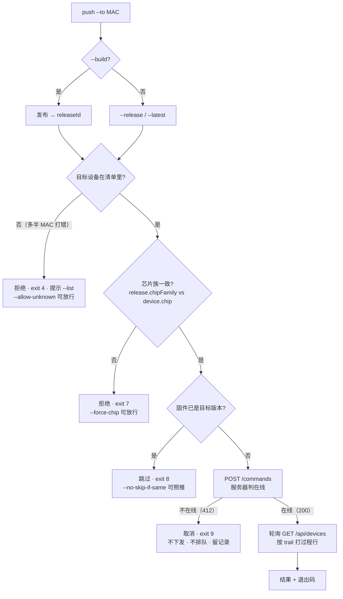
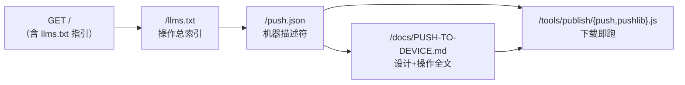

# PUSH-TO-DEVICE — 把固件推给指定设备（设计 + 操作）

> **状态：已实现并上线**（服务器准入规则 + `/OTA` 页面 + CLI + 描述符，同一批）。验收结果见 §8。
> 描述符纪律：`/push.json`、`llms.txt` 段落、`push --help` 与代码**同批上线**——只描述已经能跑的东西（§6.5）。
>
> **面向**：设备开发机（另一台电脑）上的操作者与其 AI。这份是"推送固件到设备"的**唯一入口文档**；
> 设备端固件本身的接入指南是 [`DEVICE-OTA.md`](./DEVICE-OTA.md)，OTA 三端契约是 [`ota.md`](./ota.md)。

## 0. 一页速览

| 项 | 内容 |
|---|---|
| 一句话 | 一条命令 = **发布（可选）+ 下发给指定设备 + 等结果 + 打印过程** |
| 命令 | `node tools/publish/index.js push --to <mac> [--build <dir> \| --release <id> \| --latest]` |
| 谁用 | 设备开发机（已持有发布 token 的那台）；**设备端固件无需任何改动** |
| 复用 | 发布 token、`POST /api/publish`、`GET /api/devices`、`POST …/commands`、`POST …/progress` |
| 稳定性要点 | **两步可分离**（发布成功但推送失败 → 只重推，不必重编译）；**重入幂等**（同版本已在队列 → 接着等，不报错、不重复下发）；**轮询容错**（等待期间服务器短暂不可达不误判）；**`--status` 只读复查**（CLI 中断/超时后也能看结果） |
| 服务器 | 加**一条权威规则**：下发时设备不在线 → 拒收（不下发、不排队、不等上线）、留记录、返 412（§3.1）；另加两处小件让规则可落地：撤销端点、按 id 读单条命令（§4） |
| AI 入口 | `/llms.txt` → `/push.json` → `/docs/PUSH-TO-DEVICE.md` → 下载 `/tools/publish/push.js` |
| 默认行为（用户已定） | ① 目标设备不在清单里 → **拒绝**；② 只做手动一条命令（**不做 watch 自动推送**）；③ 设备已在目标版本 → **跳过并说明**；④ 设备不在线 → **直接取消**（只留记录与提醒）；⑤ `--build` 只造**快照**，默认**不**晋升为正式版（要正式版加 `--promote`）；⑥ 支持 `--cancel` 撤销设备上的未决命令（推错了能握停） |

## 1. 目标与范围

**做**：让"刚编译完的固件 → 指定设备"变成一条可脚本化的命令，并且**能看见过程、能拿到明确结论**（退出码 + 阶段行）、**推错了能握停**（`--cancel`，§3.4）。

**不做**（明确拒绝，避免能力膨胀）：

| 不做 | 理由 |
|---|---|
| 批量 / 灰度 / 广播（"推给所有在线设备"） | 远程刷机必须一台一台、显式指定；批量一次误操作就是多台变砖 |
| watch 自动推送 | 用户已定：只做手动一条命令（现有 `publish --watch` 只发布不推送，行为不变） |
| **离线排队 / 等它上线** | 用户已定：离线即取消（§3.1）。排队会把"推了但没动静"变成新的困惑源——那正是要消灭的东西 |
| 新鉴权体系 | 现有 Bearer 已够；加 CLI 只是把"能力"变成"好用的入口"，不放大权限面 |
| 设备端改动 | 设备端只需已实现的 report / 取命令 / 回执（过程上报可选，见 `DEVICE-OTA.md` §4.5） |
| 设备开机自动检查最新版 | 另一条需求线，见 `DEVICE-OTA.md` §12 |

## 2. 操作面

### 2.1 两条主力用法

```bash
# A. 固件已在服务器上，只推不发布
node tools/publish/index.js push --to 34:85:a1:b2:c3:d4 --release 20261006-1237-cb5ebb

# B. 刚编译完（主力用法）：发布 + 推给指定设备 + 等结果
node tools/publish/index.js push --to 34:85:a1:b2:c3:d4 --build build
```

B 的输出（阶段行来自 `command.trail`，与页面「OTA 过程」面板同一份数据）：

```
[publish] ✓ 已发布 lvgl-demo-v9/ESP32-S3/20261006-2359-ab12cd（上传 1 段）
[push]    → 34:85:a1:b2:c3:d4 · ESP32-S3 · 固件 0.4.0 · online
[push]    已下发 cmd_9f2c31 → 等设备取走…
[push]    取走 +0.1s · 下载 100% +0.7s · 校验 +1.3s · 写入 100% +2.4s · 重启 +2.6s
[push]    ✓ success 总耗时 4.2s · OTA ok, rebooted to 20261006-2359-ab12cd
```

设备离线时（同一条命令，输出与结论）：

```
[push]    → 34:85:a1:b2:c3:d4 · 最后心跳 12m 前 → 不在线
[push]    ✗ 已取消：未下发、未排队。设备上线后请重跑本命令（记录已留，页面可见）
```

### 2.2 参数

| 参数 | 默认 | 说明 |
|---|---|---|
| `--to <mac\|deviceId>` | **必填**，只允许一个 | 接受 `34:85:a1:b2:c3:d4` / `34 85 A1…` / `3485a1b2c3d4`，内部归一为 12 位小写 hex |
| `--build <dir>` | config 的 `buildDir` | 先发布再推（release id 自动生成，与 `once` 同规则） |
| `--release <id>` | — | 推已有 release 或 snapshot（台架测试允许推快照） |
| `--latest` | — | 推该设备芯片对应 variant 的 `latest`；多个项目命中同一 variant 时需 `--project <id>` |
| `--project <id>` | — | 限定项目（`--latest` 解析歧义时用） |
| `--wait` / `--no-wait` | **等** | `--no-wait` 只下发即返回（在线检查仍在服务端执行） |
| `--wait-timeout <s>` | 300 | 超时未见回执 → 退出码 5 |
| `--poll <s>` | 2 | 轮询间隔（`trail` 是阶段级，2s 足够） |
| `--force` | off | 目标已有未决命令（409）时顶替（旧命令标 `superseded`） |
| `--force-chip` | off | 允许跨芯片族推（见 §3 闸门 2） |
| `--allow-unknown` | off | 允许推给从未上报过的 deviceId（默认拒绝） |
| `--skip-if-same` / `--no-skip-if-same` | **开** | 设备当前 `firmwareVersion` 已等于目标 releaseId → 跳过（退出码 8） |
| `--list` | — | 只打印设备清单（id / 芯片 / 固件 / 在线 / 最后心跳 / 最近命令）后退出；`--to <mac>` 时只列那一台 |
| `--status` | — | **只读复查**：打印该设备最近命令的状态与**完整过程链**，不下发、零副作用（`--wait` 超时或被 Ctrl+C 之后用它看结果）。**退出码与 `--wait` 的结论一致**（未回执 → 5），只是立即返回 |
| `--cancel` | — | **撤销设备上的未决命令**（推错了握停）；配合 `--reason "<说明>"` 留痕；语义与退出码见 §3.4。**不能与 `--dry-run` 一起用**（要看会撤哪条用 `--status`） |
| `--promote` | off | `--build` 造出的快照**顺手晋升为正式版**（默认不晋升，保持快照；`latest` 在发布时就已指向它，promote 不改 latest，只改 type + 写 note） |
| `--json` | off | 机器可读输出（§2.4） |
| `--dry-run` | off | 只打印**将会发生什么**，不发任何请求（因此闸门未校验、设备清单也没读——输出里会写明） |
| `--config` / `--server` | 同 `once` | 复用 `publish.config.json` 与其中的 `${FIRMWARE_PUBLISH_TOKEN}` |

> **没有** `--allow-offline` / `--queue-if-offline`：离线即取消是**不可覆盖**的规则（用户已定，§3.1）。
> 要"给关着的设备预排"，请等它上线后再跑一次——手工重跑一次的成本，远低于"以为推了其实在排队"的代价。

### 2.3 退出码（脚本与 AI 靠它判断）

| 码 | 含义 | 备注 |
|---|---|---|
| 0 | 成功（含 `--dry-run`） | 设备已回执 success |
| 1 | 设备回执 failed | 输出带 `detail`（失败原因来自设备） |
| 2 | 用法 / 参数错 | 互斥参数、非法 MAC、`--to` 缺失 |
| 3 | 鉴权失败 | 401/403（token 缺失或失效） |
| 4 | 目标不存在 | 设备**从未上报**（不在清单）/ release 不存在 / 无 `--latest` 可解析 |
| 5 | 超时未回执 | 命令仍挂 `pending`/`delivered`，可用 `--json` 看当时的 trail |
| 6 | 网络 / 服务器错误 | 连不上、5xx |
| 7 | **安全闸门拒绝** | 芯片族不匹配（需 `--force-chip`） |
| 8 | **跳过（非失败）** | 设备已在目标版本；`--json` 里 `skipped: true` |
| 9 | **设备不在线（已取消）** | 未下发、未排队；服务器留 `cancelled` 记录，页面有提醒。**等待期间命令被别人撤销**也走这个码，消息里写明取消原因 |
| 10 | **已有其他版本的未决命令** | 409 且 releaseId 不同；用 `--force` 顶替。**同一 releaseId 的 409 不算错误**——那是重入，CLI 接着等（§3.2）。等待期间本条被顶替（superseded）同样归这里 |

`--cancel` 用自己的一组码（与"推送成功与否"不同维度，不混进上表）：`0` 拦住（pending 撤销）· `11` 已取走时撤销（可能来不及）· `12` 没有可撤的未决命令 · `4` 设备/命令不存在 · `3` 鉴权 · `6` 网络。

`--status` 复用上表的**结论码**（成功 0 / 失败 1 / 已取消 9 / 被顶替 10 / 仍未回执 5），另加 `4`＝设备或命令不存在——因为它做的就是"复查第一次没看成的结论"。
Ctrl+C 中断等待的退出码是 `130`：命令仍在服务器上执行，退出前会提示用 `--status` 复查。

`4` 与 `9` 刻意分开：`4` 是"这台设备我从没见过"（MAC 打错、或从没接入过），`9` 是"这台设备我认识，但它现在不在线"——脚本/告警要能区分这两种。`9`/`10` 分开同理：离线是"现在推不了"，他版未决是"设备正忙"。

### 2.4 `--json` 输出契约

```jsonc
{
  "ok": true,                 // 是否达成（跳过也算 ok，靠 skipped 区分）
  "skipped": false,           // 命中 --skip-if-same
  "published": { "project": "lvgl-demo-v9", "variant": "ESP32-S3", "release": "20261006-2359-ab12cd", "uploaded": 1 },
  "device": { "deviceId": "3485a1b2c3d4", "chip": "ESP32-S3", "firmwareVersion": "0.4.0", "online": true, "lastSeen": "…" },
  "command": { "id": "cmd_9f2c31", "releaseId": "…", "state": "success",
               "createdAt": "…", "deliveredAt": "…", "finishedAt": "…", "detail": "OTA ok",
               "trail": [{ "phase": "downloading", "at": "…", "percent": 100 }] },
  "elapsedMs": 4200,
  "exitCode": 0,
  "error": null               // 失败时给 { code: "device_offline" | "target_unknown" | …, message, hint }
}
```

## 3. 判定顺序（闸门）



| 闸门 | 为什么必须 | 放行开关 |
|---|---|---|
| 设备必须已上报过 | 服务端对未知 deviceId **会自动建条目**（安静排队），MAC 打错时不会有任何报错——这个坑本项目已验证过 | `--allow-unknown`（放行后芯片族无从核对，输出会写明"未核对"；而从未上报的设备必然不在线，多半还是 exit 9） |
| 芯片族必须一致 | 芯片推错是**变砖级**故障，不能只靠设备端自己挡 | `--force-chip` |
| 同版本跳过 | 省一次下载与擦写（flash 寿命）；设备端幂等是第二道保险 | `--no-skip-if-same` |
| **必须在线** | 见 §3.1 | **不可放行** |
| 重入识别 | 脚本重跑、超时后重试时，你要的是"接着看结果"，而不是"报错"或"白刷一次 flash" | 同 releaseId 的未决命令 → 接着等；不同 → 409 + `--force` |

> 前两条闸门在**发布之前**（`--build` 时先在本地读 `flash_args` 得到 variant 再比对），所以闸门不过时**不会**在服务器上留下一个没人要的快照。
> 第三条对 `--build` 天然不触发（新 release id 是刚生成的），只在 `--release`/`--latest` 时起作用。

### 3.1 离线即取消（本设计的硬规则）

**规则**：设备不在线 → **不下发、不排队、不等它上线**，这次固件下发直接取消；服务器**只留一条记录**并让页面给出**提醒**。

**判定权在服务器**（不是 CLI）：`POST /api/devices/{id}/commands` 在入队前检查 `online`（服务端口径：`now - lastSeen > 45s` 即离线），不满足则**不进队**，返回：

```jsonc
// HTTP 412 Precondition Failed
{ "error": "device offline",
  "deviceId": "3485a1b2c3d4", "lastSeen": "2026-10-06T15:00:00Z", "onlineTimeoutMs": 45000,
  "cancelled": { "id": "cmd_ab12cd", "state": "cancelled", "reason": "device_offline",
                 "releaseId": "20261006-2359-ab12cd", "createdAt": "2026-10-06T15:12:00Z" } }
```

* 为什么不由 CLI 自己查在线：CLI 先 `GET /api/devices` 再 `POST /commands`，**两步之间设备可能掉线/上线**（TOCTOU）；只有服务器在入队那一刻判定才是权威的。
* 为什么用 **412** 而不是 409：409 已经表示"已有未决命令"。用不同的码，脚本与 AI 才能分别处理。
* **记录**：在设备命令列表里留一条 `state: "cancelled"` + `reason: "device_offline"` 的命令（有界，随现有 20 条上限滚动）。它**不占"未决位"**（`pending`/`delivered` 才算未决），所以设备上线后重推不会被 409 挡。
* **提醒**：页面 `/OTA` 上 ① 离线设备的「下发」按钮直接置灰并写明"设备不在线（最后心跳 X 前），下发会被取消、不会排队"；② 设备卡与「OTA 过程」面板显示最近一次 `cancelled` 记录及其原因。
* **残留窗口（诚实说明）**：离线判定本身有最长 45s 的滞后。若设备在 45s 窗口内掉线，命令会正常入队并停在 `pending`，直到设备下次上报才被取走；若它再也不回来，`--wait` 会超时（exit 5），页面能看到它停在 `pending` 并显示"设备已离线"。这是判定口径的固有误差，不是"排队等上线"。
* **设备端无需任何改动**：这是服务器侧的准入规则，设备端行为不变（仍只在自己上报时取命令）。

### 3.2 重入、阻塞与中断（"稳定推送"的关键细节）

| 场景 | 服务器返回 | CLI 行为 |
|---|---|---|
| 设备已有未决命令，releaseId **相同** | 409（带现有命令） | **不报错**：判定为同一次推送的重入（脚本重跑、`--wait` 超时后重试），把等待切到那条命令上，`--json` 里 `command.id` 是旧的那条 |
| 设备已有未决命令，releaseId **不同** | 409 | 报错 exit 10，提示 `--force` 顶替或等回执 |
| 设备离线 | 412 | exit 9（§3.1） |
| `--wait` 期间服务器短暂不可达 | 轮询失败 | **不立即判失败**：继续重试，连续 3 次失败或累计 30s 不可达才 exit 6；命令在服务器上不受影响 |
| `--wait` 期间 Ctrl+C / 进程被杀 | — | 命令仍在服务器执行；退出前打印 `已下发 <cmd_id>，设备会照做；用 push --status --to <mac> 复查` |

> 为什么重入要当"正常"处理：推送是**远程副作用**操作，脚本/网络的重试是常态；把重入报成失败会让人去 `--force`，
> 而 `--force` 会**顶替**掉正在执行的那条命令（白刷一次 flash，甚至把设备留在一个中间状态）。重入必须"接着等"。

### 3.4 撤销未决命令（`--cancel`）

```bash
node tools/publish/index.js push --cancel --to 34:85:a1:b2:c3:d4 --reason "推错了版本，先停"
```

服务端：`POST /api/devices/{id}/commands/{cid}/cancel`（**Bearer**，运维侧动作，与 `result`/`progress` 的设备侧动作相对）
→ 把 `pending` 或 `delivered` 的命令标 `cancelled` + `reason`（默认 `cancelled_by_operator`）。

**两种情形语义不同，必须如实区分**：

| 撤销时的状态 | 拦得住吗 | 服务器行为 | 退出码 |
|---|---|---|---|
| `pending`（设备还没取走） | ✅ **拦住了**：设备下次上报不会再拿到它 | 标 `cancelled`，未决位释放 | 0 |
| `delivered`（设备已取走） | ⚠️ **拦不住正在写的设备**——但**能停掉重复投递**：取走未回执时服务器本来会一直再投同一条，撤销后不再投 | 标 `cancelled`；若设备随后仍发来 `result`，**不覆盖 cancelled**，把回执记进 `lateResult` 字段并在页面标注"设备已完成（撤销来晚了）" | 11 |
| 命令已结束（success/failed/superseded/cancelled） | — | 409，不可撤销 | 12 |
| 设备/命令不存在 | — | 404 | 4 |

**为什么"已取走也允许撤"**：这是唯一能停掉"重复投递死循环"的手段（设备取走后崩了、永远不回执，服务器就会每次上报都再投一次）。
**为什么不静默成功**：撤销 delivered 时打印明确警告——"设备已取走，可能已经在写入：能停掉重复投递，但无法远程中断本次写入"。
**设备端无需改动**：它只在自己上报时取命令；被撤销的命令不再出现，已取走的它照旧完成并回执（回执被记为 `lateResult`）。

### 3.3 失败与超时时必须打印的"过程证据"

不管退出码是几，CLI 退出前都要把**已有过程**打全，这是"看得见过程"的最低要求：

* 完整过程链：`已下发 → 设备取走 → 各阶段（含 percent / message）→ 回执`，每步带**相对耗时**；
* 若停在某一步：带上"停滞了多久"（与页面同源规则：`pending > 30s`、`delivered` 无过程 > 2min、过程 > 60s 未更新）；
* 设备端**没上报过程**时：明确写出"设备端未上报过程点（旧固件/未实现）——以上仅为服务器可见的时间点"，**不假装有进度**。

## 4. 契约与依赖

| 依赖 | 端点 | 鉴权 | 用途 |
|---|---|---|---|
| 发布 | `POST /api/publish`（multipart） | Bearer | `--build` 时先发布（复用 `tools/publish/once.js`） |
| 设备清单 | `GET /api/devices` | 公开 | 找设备、校验目标、读芯片/固件/在线、**取 `unresolved`（撤销的对象）** |
| 单条命令 | `GET /api/devices/{id}/commands/{cid}` | 公开 | 等待时**按 id 精确轮询**（新增，理由见下） |
| 下发 | `POST /api/devices/{id}/commands` | Bearer | 下发 OTA；**离线 → 412 并留 cancelled 记录**；409 = 已有未决命令；`{"force":true}` 顶替 |
| 撤销 | `POST /api/devices/{id}/commands/{cid}/cancel` | Bearer | 把未决命令标 `cancelled`（§3.4）；**新增端点** |
| 晋升（可选） | `POST /api/registry/projects/{pid}/variants/{vid}/releases/{rid}/promote` | Bearer | `--promote` 时把快照转正式版（端点已存在） |
| 过程 | 命令摘要里的 `progress` / `trail` | 公开（随清单返回） | 打过程行、算卡住判定 |
| 结果 | 命令摘要里的 `state` / `detail` / `finishedAt` | 公开 | 结论与退出码 |

**服务端实际新增了两处**（都不是新能力，是让上述两条规则可落地）：

* `POST /commands` 入队前判在线 → 412 + cancelled 记录（§3.1）。**规则全局生效**：页面下发走同一个端点，因此 `/OTA` 页的下发也会同样被拒——一处规则、两条入口行为一致。
* `GET /api/devices/{id}/commands/{cid}`（公开只读）与设备视图里的 `unresolved` 字段：
  - 视图只给"最近一条"**不够**——设备离线时再下发会新增一条更新的 `cancelled` 记录，把还在队列里的 `pending` 顶下去；只看 `lastCommand` 会**撤错对象或以为没命令可撤**（`unresolved` 专门给出未决那条）；
  - 等待期间也同理：按 id 读才不会被"更新的记录"遮住，能一直看到**这一条**的结局（否则超时后连它是成功还是被顶替都无从得知）。

## 5. 文件与职责（分）

| 文件夹 | 文件 | 新/改 | 职责（一句话） |
|---|---|---|---|
| `tools/publish/` | `pushlib.js` | **新** | 纯逻辑、零 IO：MAC 归一、参数解析与互斥校验、设备选取、芯片比对、同版本判定、trail→过程行渲染、停滞判断、退出码判定（**可单测**） |
| `tools/publish/` | `push.js` | **新** | 编排：解析参数 → 过闸门 →（可选）发布 → 下发 → 轮询 → 打印/`--json`（唯一有 IO 的部分） |
| `tools/publish/` | `index.js` | 改 | 加 `push` 子命令分派 + `usage()`（`promote` 是现成模板） |
| `tools/publish/` | `lib.js` `watch.js` | 不改 | 复用 `parseConfig` / `buildParts` / `parseFlashArgs` |
| `tools/publish/` | `once.js` | 改 | `runOnce` 返回值补一个 `uploaded`（本次实际传输段数），行为不变——`push --json` 要用 |
| `server/` | `devices.js` | 改 | 新增 `cancelled` 状态与 `recordCancelled()`（留记录不占未决位）+ `cancelCommand()`（撤销未决命令、记 `lateResult`）+ `isDeviceOnline()`；设备视图补 `unresolved` |
| `server/` | `app.js` | 改 | `POST /commands` 入队前判在线 → 离线返 **412** + 写 cancelled 记录；新增 `POST …/commands/{cid}/cancel` 与 `GET …/commands/{cid}` |
| `tests/` | `push-cli.test.js` | **新** | 纯逻辑 36 用例 + 端到端 28 用例（起真服务器 + 模拟设备，跑真 CLI，逐条对 §8 验收项） |
| `tests/` | `devices.test.js` | 改 | 补：离线下发 → 412 + cancelled 记录 + 未决位不被占用 + 上线后可重推；撤销 pending/delivered；迟到回执不覆盖 cancelled；`unresolved` 字段；按 id 读单条 |
| `tests/` | `static-pages.test.js` | 改 | 补：页面离线/撤销接线、`ota.json` 的 412/cancelled、`llms.txt`、**CLI 源码镜像字节级一致**且能直接跑 |
| `public/ota/` | `ota.js` `ota.css` `index.html` | 改 | 离线设备按钮置灰与文案；`cancelled` 状态标签与提醒；过程面板显示取消原因与"迟到回执"；**未决命令上的「撤销」按钮**（同一规则也要在控制台上能用，不能只有 CLI 有） |
| `docs/` | `PUSH-TO-DEVICE.md` | **新**（本文） | 本功能的唯一入口文档（设计 + 操作 + AI 面） |
| `docs/` | `ota.md` | 改 | §4.3 补 412 与 `cancelled`；§7 决策表补"离线即取消" |
| `docs/` | `DEVICE-OTA.md` | 改 | §4.3/§4.7 补 412（设备端无需改，但要能解释"为什么我的命令没来"）；加 2 行指向本文 |
| `docs/` | `PUBLISH.md` | 改 | 加「推送固件到设备」一节（发布流程之后） |
| `public/docs/` | 上述文档镜像 | 改 | 双份纪律：`docs/` 是源，改完拷过来 |
| `public/` | `push.json` | **新** | AI 机器描述符（§6.2），与代码同批上线 |
| `public/ota.json` `ota/index.html#ai-data` `llms.txt` | 改 | 补 `cancelled` 状态、412 语义、"离线不下发"规则、撤销语义、`unresolved` 字段；`llms.txt` 另加推送段（§6.3） |
| `public/tools/publish/` | 六个 `.js` | **新/改** | CLI 源码托管：设备机不 clone 也能下载即跑（`static-pages.test.js` 守住与 `tools/publish/` 字节级一致） |
| **不动** | `src/**`（主 SPA） | — | 烧录页不涉及（那是 USB 本地烧录路径） |

## 6. AI 可读面（AI 访问站点后要知道"有哪些操作、怎么做"）

### 6.1 发现链路



一条铁律：**AI 只靠 `GET /` + `/llms.txt` 就必须能发现本功能**——不认识"推送"这个词的 AI，也要能从索引里读到它的用途、命令形态与文档地址。

### 6.2 `/push.json`（机器描述符，已上线）

`tool_id=push-cli`。内容就是本文件 §2/§3 的结构化版本：`entrypoints`（源码/文档/同源描述符）、`requires`、`usage`（六种用法）、`params`、`exit_codes`（含 `noOfflineOverride` 的说明）、`gates`、`apis`、`command_states`、`process_visibility`（打什么、失败时打什么、不假装进度）、`json_output`、`related_tools`（`/ota.json`、设备模拟器）、`not_implemented`（批量/自动推送/离线排队/设备自检更新）。

**它读起来必须是"能跑的"而不是"打算做的"**：例如 `--cancel` 那条同时写明"撤销对象取自服务器的 `unresolved`，不是 `lastCommand`"。改 CLI 行为时同步改它，否则 AI 会照着过期描述调用（§6.5）。

### 6.3 `llms.txt` 推送段（已上线）

索引里有一节「推送固件到指定设备（设备开发机 CLI，零依赖）」：一句话用途 + `/push.json` + `/docs/PUSH-TO-DEVICE.md` + 源码地址 + 一条示例命令 + 闸门要点（含**离线不下发**与 `--status`/`--cancel`）+ "刻意不做"清单。
另在「详细文档」与「示例」两处补了本文与 `/push.json` 的入口——**不认识"推送"这个词的 AI，也要能从索引里读到它的用途、命令形态与文档地址**。

### 6.4 AI 自查三连（文档里要写死，便于照抄）

```bash
curl -s http://<host>/llms.txt | grep -A4 推送        # 1) 站点有哪些操作
curl -s http://<host>/push.json                       # 2) 本功能的参数/退出码/闸门
curl -s http://<host>/api/devices                     # 3) 现在有哪些设备（拿 deviceId 并看 online）
```

### 6.5 描述符纪律

`/push.json`、`llms.txt` 段落、`push --help`、以及 `ota.json` 里的 `cancelled`/412 说明 **必须与实现同批上线**。
本项目已吃过一次亏：曾经 `ota.json` 把已上线的端点写成 `implemented: false`、把"设备端未实现"写成事实，AI 读到的能力与现实不符——
描述符只允许描述**已经能跑**的东西。本功能落地时遵守了这条：设计稿先上线、而 `/push.json` 与 `llms.txt` 的 push 段一直等到 CLI 跑通才随代码上线（此前线上可查：`llms.txt` 无 push 段、`dist/push.json` 不存在）。

## 7. 失败模式与排查

| 现象 | 退出码 | 原因 | 怎么办 |
|---|---|---|---|
| `目标设备不在清单里` | 4 | MAC 打错，或设备从未上报 | `--list` 对照；确认设备在跑上报循环；确要预排加 `--allow-unknown` |
| `芯片族不匹配` | 7 | 推了别的芯片的固件 | 核对 variant；确要强推加 `--force-chip` |
| `跳过了` | 8 | 设备已在该版本 | 想重刷加 `--no-skip-if-same` |
| **`设备不在线，已取消`** | 9 | 下发的瞬间设备离线（最后心跳 > 45s） | 设备上线后**重跑本命令**；页面 `/OTA` 能看到这次取消的记录与原因 |
| `401` | 3 | token 缺失/失效 | 设 `FIRMWARE_PUBLISH_TOKEN` 或 config 的 `token`（建议用可撤销的工作 token） |
| `409 已有未决命令` | — | 设备上一条命令还没回执 | 见 §3.2：同版本=接着等；他版本=exit 10，等回执或 `--force` |
| 轮询中服务器短暂不可达 | — | 网络抖动 / 服务器重启 | CLI 自动重试；连续 3 次或累计 30s 才 exit 6，**命令不受影响**（状态在服务器上） |
| CLI 被中断 / 超时后想知道结果 | 130 / 5 | 进程没了但命令还在跑 | `push --status --to <mac>`（只读）；或页面 `/OTA` 的过程面板 |
| **发布成功、推送失败** | 9/7/10 | 固件已成 **snapshot** 躺在服务器上 | **不必重编译**：`push --to <mac> --release <id>` 再推一次；要转正式版用 `promote`；不想要就等 retention 清理 snapshot |
| 网络/服务器错误 | 6 | 连不上、5xx | 两步可分离：重跑时 `--build` 会因增量上传（按 sha 复用）秒回，不会重传固件 |
| **撤销后设备仍完成了** | 11 | 撤销时命令已被取走，设备本地照旧写完并回执 | 服务器**不覆盖** `cancelled`，回执记进 `lateResult`；页面标注"设备已完成（撤销来晚了）"——要回到旧版本就再推一条 |
| **撤销时命令已结束** | 12 | 想停但已经跑完/被顶替 | 无需操作；`--status` 看最终状态 |
| `--promote` 之后 latest 没变 | — | 发布那一刻 `variant.latest` 就指向了新 release（不管 snapshot 还是 release） | promote **只把快照的 type 改成正式版**并写 note，不改 latest。要 latest 指向别的版本用「回滚/切换 latest」接口 |
| 超时 | 5 | 下发时在线、之后掉了/正忙/断电 | `--json` 看 `trail` 停在哪一步；页面 `/OTA` 有同款过程视图 |
| 设备回执 failed | 1 | 下载校验失败、写入失败等 | 看输出里的 `detail`（设备给的原文）；再跑一次通常能区分偶发/必然 |

## 8. 验收清单（已全部通过）

下面每一条都在 `tests/push-cli.test.js`（**30 个端到端用例，起真服务器 + 模拟设备、跑真 CLI**，另有 36 个纯逻辑用例）与 `tests/devices.test.js` / `tests/static-pages.test.js` 里有对应断言；括号里是验证方式。

- [x] `push --list` 列出设备（id/芯片/固件/在线/最后心跳/最近命令）；`--list --to <陌生 MAC>` → exit 4（e2e）
- [x] `--release` 推已有版本：下发 → 取走 → 各阶段过程行 → 回执 → exit 0（e2e，断言 `过程：下载固件 100%`、`✓ success 总耗时`）
- [x] `--build` 发布 + 推送一条龙，输出含 release id 与上传段数；默认产出 **snapshot**（`--promote` 才把 type 转成 release；`latest` 在发布时就已指向它）（e2e）
- [x] MAC 打错 → exit 4，且**没有**在服务器上建出幽灵设备（前后对比 `GET /api/devices` 数量一致）（e2e）
- [x] 芯片不匹配 → exit 7 且未下发；`--force-chip` 才放行（e2e）
- [x] 设备已在目标版本 → exit 8 且未下发；`--no-skip-if-same` 可照推（e2e）
- [x] **设备离线 → exit 9**：未排队（无 pending）、有 `cancelled`+`reason: device_offline` 记录、页面可见该记录与提醒（e2e + `static-pages` 接线守卫）
- [x] **离线期间重推**仍 exit 9（不因 409 被挡）；**设备上线后重推**正常 200 并成功（e2e）
- [x] 页面：离线设备「下发」按钮置灰 + 写明"下发会被取消、不会排队"；在线设备行为不变（DOM 桩 28/28 项，含选中离线设备后按钮仍置灰）
- [x] 他版本未决 → exit 10 并提示 `--force`；`--force` 后旧命令标 `superseded`（e2e）
- [x] **重入**：同版本已是未决命令时重跑 → 不报错、不重复下发、接着等出结论 exit 0（e2e，断言服务器上只有 1 条命令）
- [x] **轮询容错**：等待期注入 2 次 502 → 不误判、恢复后仍给结论 exit 0；持续不可达才 exit 6 且明说"命令不受影响"（e2e，用转发代理注入故障）
- [x] **中断可复查**：SIGINT 打印 `命令仍在服务器执行` + `--status` 提示（实现层 + e2e 的 `--status` 用例）
- [x] **发布成功推送失败只需重推**：`--build` 遇离线 exit 9 后 `--release <snapshot>` 直接成功，输出无 `[publish]`（e2e）
- [x] 失败/超时打印**完整过程链**（每步相对耗时）+ "停在哪一步" + 停滞判断；设备未上报过程时**明说**（e2e）
- [x] 故障注入：① 设备取走后断电不回执 → exit 5 + `命令停在 delivered` + 回来后被重复投递 ② 轮询期服务器不可达 → 见上 ③ 等待期 token 被撤销 → 等待照常完成（轮询是公开只读），但同一 token 不能再下发（401）（e2e）
- [x] **撤销 pending** → exit 0；设备下次上报取不到它；状态 `cancelled` + 原因（e2e）
- [x] **撤销 delivered** → exit 11 + 警告；设备随后回执 → 状态**保持** `cancelled`、记进 `lateResult`、**重复投递被停掉**（e2e）
- [x] 没有未决命令 / 命令已结束时 `--cancel` → exit 12（e2e）
- [x] 页面也能撤销：未决命令上有「✋ 撤销未决命令」按钮，撤的是 `unresolved`（不是最近记录），与 CLI 同一端点（DOM 桩 + 接线守卫）
- [x] `--no-wait` 只下发即返回；`--dry-run` 零请求（连不上的地址也 exit 0）；`--json` 结构与 §2.4 一致（失败时 `error.code` 也一致）（e2e）
- [x] 设备回执 failed → exit 1 且打印设备 `detail`（e2e）
- [x] 测试全绿；`public/tools/publish/*.js` 与 `tools/publish/*.js` **字节级一致**且能直接跑（`static-pages.test.js` 守卫生效）

**仍需在设备机上做一次的事**（本机做不到，因为真机与设备工程在另一台电脑）：用真机 `b81f3fc8768c` 跑一遍 `push --to ... --release <id>`，确认设备端下载/写入/回执与过程上报在真实链路上如预期。CLI 侧的行为已被上面的 e2e 全覆盖。

## 9. 实施顺序（已按序落地）

1. ✅ **服务器准入规则 + 撤销**：`devices.js`（`cancelled`/`recordCancelled()`/`cancelCommand()`/`lateResult`/`isDeviceOnline()`/视图 `unresolved`）+ `app.js`（412 + cancel + 按 id 读单条）+ `tests/devices.test.js` 补齐
2. ✅ **页面同步**：`/OTA` 离线按钮置灰与文案 + `cancelled` 标签/提醒 + 过程面板取消原因与迟到回执 + 未决命令的撤销按钮；`ota.json` / `#ai-data` 补状态、412、cancel、`unresolved`；顺手修掉"点卡片后过程面板要等 5s 才刷新"的旧缺陷
3. ✅ `pushlib.js` + 单测（纯逻辑 36 用例）
4. ✅ `push.js`（`--release`/`--wait`/`--status`/`--json` 先行）→ 临时服务器端到端
5. ✅ `--build`（复用 `once.js`，**发布给 1 次重试**）+ `--promote` + `--cancel` + `--list`/`--dry-run` + 各闸门与重入 → 全清单验收
6. ✅ `index.js` 子命令 + `usage()`；镜像到 `public/tools/publish/`（6 个文件）
7. ✅ 文档（本文 + `ota.md`/`DEVICE-OTA.md`/`PUBLISH.md`）+ `push.json` + `llms.txt` 段
8. ✅ `test` + `build` 全绿 → 提交 → 按纪律 9 部署 → 线上核验

> 与设计相比**只多做了两件小事**，都写进 §4 了：设备视图的 `unresolved` 字段、`GET /api/devices/{id}/commands/{cid}` 按 id 读单条。
> 原因不是"想要更多功能"，而是原设计里的两处会在真实场景下**静默出错**：撤销会撤错对象、等待会看不到自己那条命令的结局。
